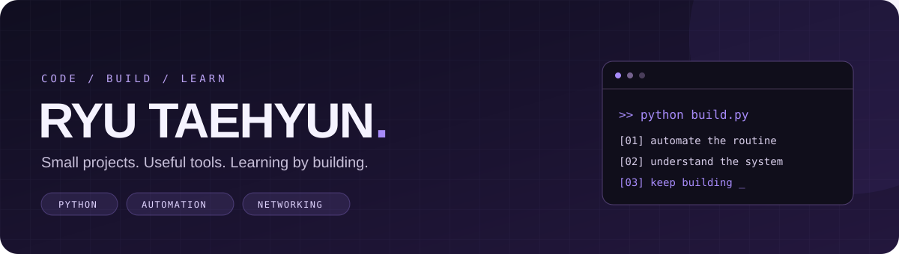

  

  <b>반복 작업은 자동화하고, 궁금한 동작은 직접 구현하며 배웁니다.</b> 
  Python으로 작은 프로젝트를 실행 가능한 도구로 만들고, 배운 내용과 실행 방법을 함께 기록합니다.

  <a href="https://github.com/Ryu-Taehyun?tab=repositories">프로젝트 둘러보기 ↗</a>
  &nbsp; · &nbsp;
  <a href="https://github.com/Ryu-Taehyun/Auto-Litural-Terminal">터미널 자동화 도구 ↗</a>

---

### 🟣 Working with

  
  
  
  
  
  

### ✦ Selected projects

| Project | What I built | Stack |
| :--- | :--- | :--- |
| **[Auto-Litural-Terminal ↗](https://github.com/Ryu-Taehyun/Auto-Litural-Terminal)** | 메뉴로 설정하고 실행하는 리추얼 자동화 도구. Slant 배너, 입력 속도 선택, 설정 검사와 진행 로그를 제공합니다. | `Python` `Playwright` `CLI` |
| **[Auto-Litural ↗](https://github.com/Ryu-Taehyun/Auto-Litural)** | 아침·마무리 리추얼의 반복 입력을 돕는 웹 UI. 다크/라이트 모드와 입력 속도 선택을 지원합니다. | `Python` `Playwright` `Web UI` |
| **[Remote-Desktop ↗](https://github.com/Ryu-Taehyun/Remote-Desktop)** | TCP 소켓으로 명령을 교환하고, 화면을 캡처해 JPEG로 전송·표시하며 통신 흐름을 실습합니다. | `Socket` `OpenCV` `NumPy` |

### ↗ Learning by building

<table>
  <tr>
    <td width="50%" valign="top">
      <b>01 / Automation</b>  
      반복 입력을 줄이는 Python 도구를 만들고, 
      브라우저 자동화와 사용하기 쉬운 실행 흐름을 익힙니다.
    </td>
    <td width="50%" valign="top">
      <b>02 / Systems &amp; Data</b>  
      TCP 소켓, 화면 캡처와 이미지 변환을 구현하고, 
      API 요청부터 데이터 처리까지 이어지는 흐름을 배웁니다.
    </td>
  </tr>
</table>

  작게 만들고, 직접 실행하고, 배운 내용을 남깁니다.

